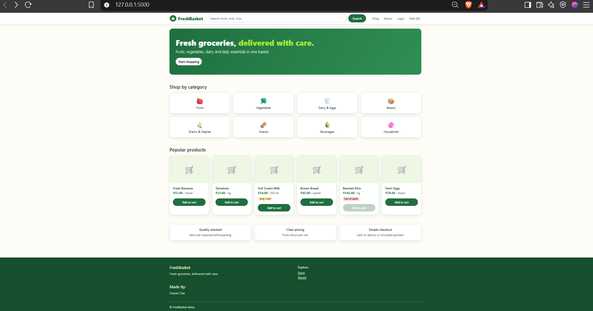
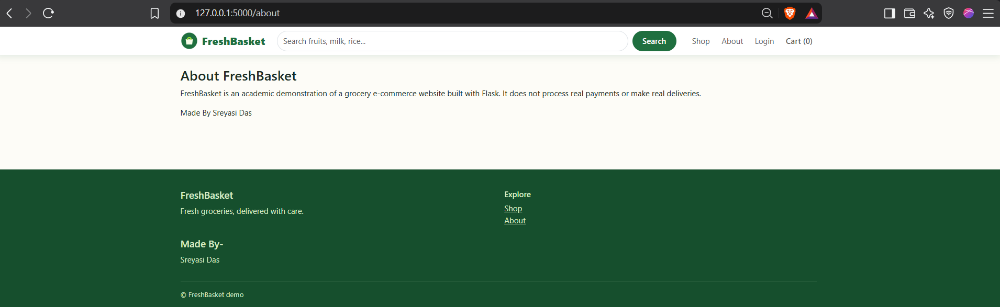

# FreshBasket — E-Commerce Grocery Web Application 🛒

FreshBasket is a full-stack e-commerce web application built using Python and Flask. Designed for online grocery shopping, it provides a clean, responsive interface for users to browse products, filter categories, manage shopping carts, and handle user sessions.

## Project Preview

  

  

  

## Features

- Product Catalog & Categorization: Browse fruits, vegetables, dairy, bakery items, and daily essentials with category-based filtering.
- User Authentication: Integrated user session management powered by Flask-Login.
- Dynamic Frontend Templates: Clean, modern user interface built using Jinja2 templating, HTML5, CSS3, and JavaScript.
- Database Architecture: Relational database integration using Flask-SQLAlchemy and Flask-Migrate for schema management.
- Modular Design: Structured using the Flask Application Factory pattern and modular Blueprints.

## Tech Stack

- Backend: Python 3, Flask, Flask-SQLAlchemy, Flask-Login, Flask-Migrate, Flask-WTF
- Frontend: HTML5, CSS3, JavaScript, Jinja2
- Database: SQLite
- Environment Management: python-dotenv

## Getting Started

### Prerequisites

- Python 3.10+
- pip package manager

### Installation & Setup

1. Clone the repository:
   git clone https://github.com/Sreyasi27/FreshBasket--A-Grocery-Website.git
   cd FreshBasket

2. Create and activate a virtual environment:
   python -m venv venv
   .\venv\Scripts\Activate.ps1

3. Install dependencies:
   pip install -r requirements.txt

4. Configure environment variables:
   Copy-Item .env.example .env

5. Run the application:
   python run.py

6. Open your browser and navigate to http://127.0.0.1:5000
